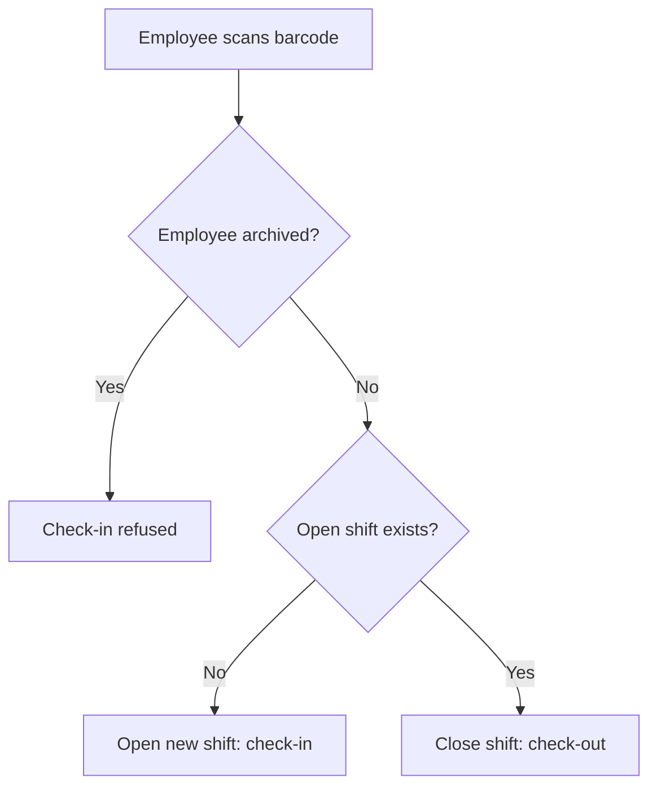
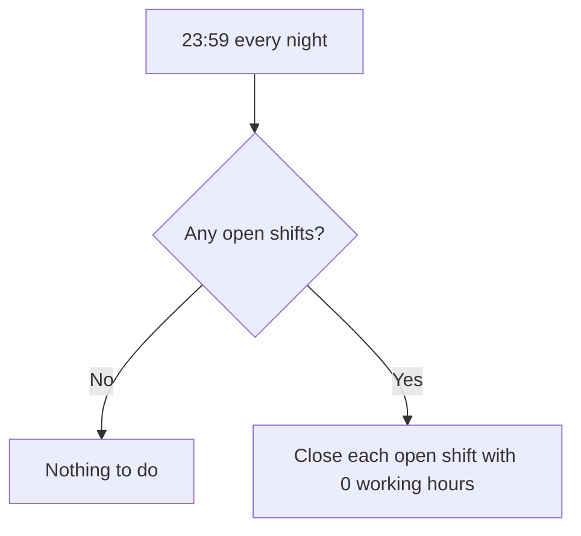

# Business Analysis Sample: Attendance & Working Hours Management System

*Author: Vasilije Jovanović. This document describes the system from a business analyst's point of view (needs, rules and processes), not from a developer's. It was written afterwards, based on the application I built and its README.*

---

## 1. Purpose

The company needs a reliable way to record when employees start and finish work and to calculate how many hours each employee worked, without manual paperwork and with as little effort as possible at the entrance.

**Goals**

- Record arrivals and departures quickly, using a barcode scanner.
- Keep an accurate history of working hours per employee.
- Give HR a simple way to manage employees and review hours for any period.
- Prevent incorrect data caused by forgotten check-outs.

## 2. Actors

| Actor | Description | Main need |
|---|---|---|
| Employee | Person who scans their barcode at the entrance terminal | Check in and out in a few seconds, without using a mouse or keyboard |
| HR administrator | Person who manages employees and reviews hours | Manage staff, keep work history intact, get hour reports for a chosen period |
| System (scheduler) | Automatic nightly service | Close shifts that were left open so the data stays correct |

## 3. Functional requirements

| ID | Requirement |
|---|---|
| FR-1 | The entrance terminal shows a real-time clock. |
| FR-2 | The terminal is always ready to receive a barcode scan, with no mouse interaction needed. |
| FR-3 | On a scan, the system checks in the employee if they have no open shift, and checks them out if they have one. |
| FR-4 | Archived employees cannot check in. |
| FR-5 | The admin area is accessible only to authorized users; others are redirected away. |
| FR-6 | HR can archive an employee instead of deleting them, so work history and reports are preserved. |
| FR-7 | HR can filter reports by a custom date range ("from – to"). |
| FR-8 | The system calculates exact working hours per employee for the selected range. |
| FR-9 | Every night at 23:59 the system closes forgotten open shifts with 0 working hours. |

## 4. User stories and acceptance criteria

**US-1: Check in / check out**
As an employee, I want to scan my barcode to start or end my shift, so that my working time is recorded without extra steps.

- *Given* I have no open shift, *when* I scan my barcode, *then* a new shift is opened.
- *Given* I have an open shift, *when* I scan my barcode, *then* my shift is closed.
- *Given* I am at the terminal, *when* I scan, *then* I do not need to click anything first.

**US-2: Archived employees**
As an HR administrator, I want to archive an employee who has left, so that their history is kept but they can no longer check in.

- *Given* an employee is archived, *when* they scan their barcode, *then* check-in is refused.
- *Given* an employee is archived, *when* I view past reports, *then* their earlier hours are still included.

**US-3: Hours report**
As an HR administrator, I want to see worked hours for a chosen period, so that I can review attendance.

- *Given* I select a start and end date, *when* I open the report, *then* I see the exact worked hours for that range.

**US-4: Forgotten check-out**
As an HR administrator, I want forgotten shifts to be closed automatically, so that one missing scan does not corrupt the following days.

- *Given* a shift is still open at 23:59, *when* the nightly service runs, *then* the shift is closed with 0 working hours.

**US-5: Protected admin area**
As an HR administrator, I want the admin area to be protected, so that only authorized people can see or change employee data.

- *Given* a user is not authorized, *when* they open an admin page, *then* they are redirected away.

## 5. Process flow

### 5.1 Scanning at the terminal

### 5.2 Nightly shift closing

## 6. Business rules

1. One scan always means one of two things: start a shift or end the open shift.
2. An employee has at most one open shift at a time.
3. Employees are never permanently deleted; they are archived to protect history and report accuracy.
4. A shift left open overnight is closed automatically with 0 working hours, so days never overlap.