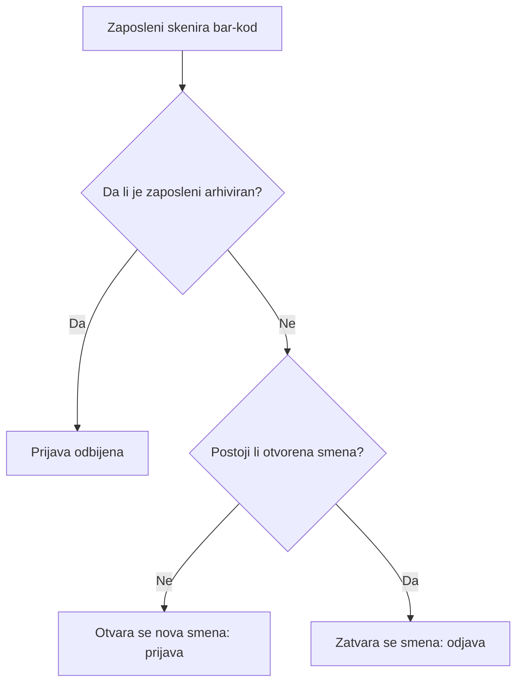
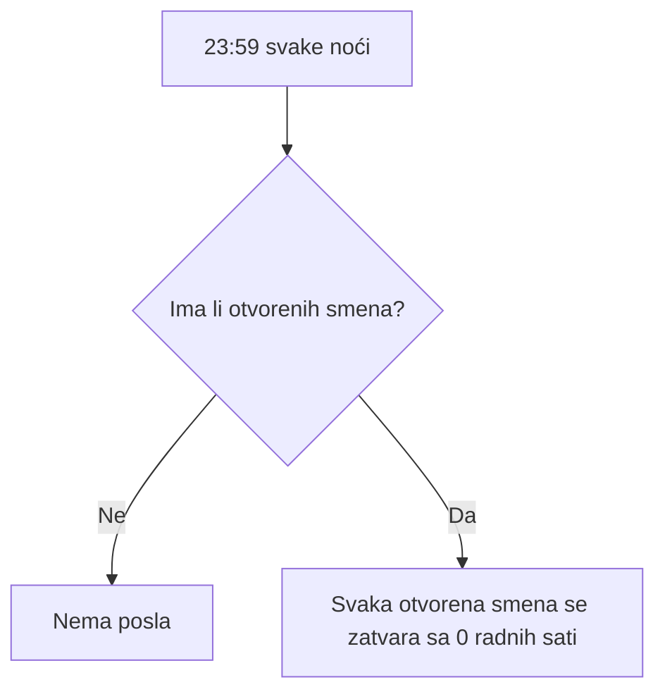

# Primer poslovne analize: Sistem za evidenciju prisustva i radnih sati

*Autor: Vasilije Jovanović. Ovaj dokument opisuje sistem iz ugla poslovnog analitičara (potrebe, pravila i procesi), a ne iz ugla programera. Napisan je naknadno, na osnovu aplikacije koju sam napravio i njenog README fajla.*

---

## 1. Svrha

Firmi je potreban pouzdan način da beleži kada zaposleni počinju i završavaju posao i da računa koliko je sati svaki zaposleni radio, bez papirologije i uz što manje truda na ulazu.

**Ciljevi**

- Brzo beležiti dolaske i odlaske pomoću čitača bar-koda.
- Čuvati tačnu istoriju radnih sati po zaposlenom.
- Omogućiti HR-u jednostavno upravljanje zaposlenima i pregled sati za bilo koji period.
- Sprečiti netačne podatke koji nastaju kada neko zaboravi da se odjavi.

## 2. Učesnici

| Učesnik | Opis | Glavna potreba |
|---|---|---|
| Zaposleni | Osoba koja skenira svoj bar-kod na terminalu na ulazu | Da se prijavi i odjavi za par sekundi, bez miša i tastature |
| HR administrator | Osoba koja upravlja zaposlenima i pregleda sate | Da upravlja osobljem, sačuva istoriju rada i dobije izveštaj sati za izabrani period |
| Sistem (automatski servis) | Noćni servis koji radi sam | Da zatvori smene koje su ostale otvorene, kako podaci ostanu tačni |

## 3. Funkcionalni zahtevi

| ID | Zahtev |
|---|---|
| FR-1 | Terminal na ulazu prikazuje sat u realnom vremenu. |
| FR-2 | Terminal je uvek spreman da primi skeniranje bar-koda, bez potrebe za klikom mišem. |
| FR-3 | Pri skeniranju sistem prijavljuje zaposlenog ako nema otvorenu smenu, a odjavljuje ga ako je ima. |
| FR-4 | Arhivirani zaposleni ne mogu da se prijave. |
| FR-5 | Administratorskom delu pristupaju samo ovlašćeni korisnici, ostali se preusmeravaju. |
| FR-6 | HR može da arhivira zaposlenog umesto da ga briše, kako bi istorija rada i izveštaji ostali sačuvani. |
| FR-7 | HR može da filtrira izveštaje po proizvoljnom opsegu datuma („od – do"). |
| FR-8 | Sistem računa tačne radne sate po zaposlenom za izabrani opseg. |
| FR-9 | Svake noći u 23:59 sistem zatvara zaboravljene otvorene smene sa 0 radnih sati. |

## 4. Korisničke priče i uslovi prihvatanja

**US-1: Prijava / odjava**
Kao zaposleni, želim da skeniram svoj bar-kod da počnem ili završim smenu, kako bi mi se radno vreme beležilo bez dodatnih koraka.

- *Ako* nemam otvorenu smenu, *kada* skeniram bar-kod, *onda* se otvara nova smena.
- *Ako* imam otvorenu smenu, *kada* skeniram bar-kod, *onda* se moja smena zatvara.
- *Ako* sam na terminalu, *kada* skeniram, *onda* ne moram prvo ništa da kliknem.

**US-2: Arhivirani zaposleni**
Kao HR administrator, želim da arhiviram zaposlenog koji je otišao, kako bi mu istorija ostala sačuvana, a on više ne mogao da se prijavi.

- *Ako* je zaposleni arhiviran, *kada* skenira bar-kod, *onda* je prijava odbijena.
- *Ako* je zaposleni arhiviran, *kada* pregledam prethodne izveštaje, *onda* su njegovi raniji sati i dalje uključeni.

**US-3: Izveštaj o satima**
Kao HR administrator, želim da vidim radne sate za izabrani period, kako bih pregledao prisustvo.

- *Ako* izaberem početni i krajnji datum, *kada* otvorim izveštaj, *onda* vidim tačne radne sate za taj opseg.

**US-4: Zaboravljena odjava**
Kao HR administrator, želim da se zaboravljene smene zatvaraju automatski, kako jedno propušteno skeniranje ne bi pokvarilo podatke narednih dana.

- *Ako* je smena i dalje otvorena u 23:59, *kada* se pokrene noćni servis, *onda* se smena zatvara sa 0 radnih sati.

**US-5: Zaštićen administratorski deo**
Kao HR administrator, želim da administratorski deo bude zaštićen, kako bi podatke o zaposlenima mogli da vide i menjaju samo ovlašćeni.

- *Ako* korisnik nije ovlašćen, *kada* otvori administratorsku stranicu, *onda* se preusmerava.

## 5. Tok procesa

### 5.1 Skeniranje na terminalu

### 5.2 Noćno zatvaranje smena

## 6. Poslovna pravila

1. Jedno skeniranje uvek znači jedno od dvoje: početak smene ili kraj otvorene smene.
2. Zaposleni ima najviše jednu otvorenu smenu u isto vreme.
3. Zaposleni se nikada ne brišu trajno, već se arhiviraju da bi se sačuvale istorija i tačnost izveštaja.
4. Smena koja ostane otvorena preko noći zatvara se automatski sa 0 radnih sati, pa se dani nikada ne preklapaju.